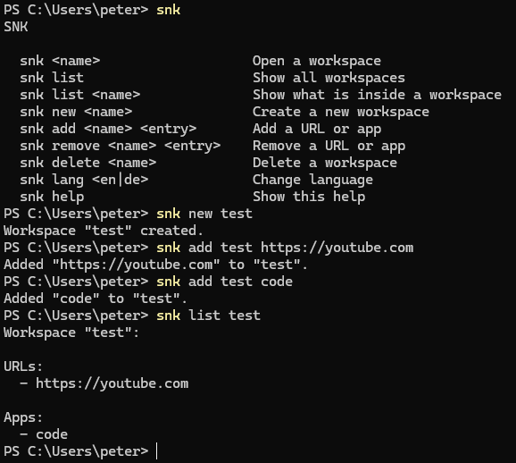

# SNK

SNK is a small command line tool for Windows that opens all your tabs and apps with one command.
I made this tool because I was always opening the same websites and apps for different things and I thought why not do it like this.
The name SNK has no real meaning, it is just a command that is easy to type (short) and is not used by any other application that I know.

I built this while I was still a beginner at C#, so I used AI to help me.



## Why use SNK

Let's say you want to start coding. Normally you would open GitHub, your IDE and maybe some docs one by one.
With SNK you save all of that once in a workspace called `dev`, and from then on you just type `snk dev` and everything opens at the same time.

You can make different workspaces for different things, for example:

- `snk fun` for watching YouTube or a livestream and maybe a game
- `snk dev` for coding
- `snk dev2` for a different coding project

## Built with

- C#
- .NET
- [YamlDotNet](https://github.com/aaubry/YamlDotNet) for the language files

## How to use it

```
snk <name>                   Open a workspace
snk list                     Show all workspaces
snk list <name>              Show what's inside a workspace
snk new <name>               Create a new workspace
snk add <name> <url or app>  Add a URL or app
snk remove <name> <entry>    Remove a URL or app
snk delete <name>            Delete a workspace
snk lang <en|de>             Change the language
snk help                     Show help
```

Example:

```
snk new dev
snk add dev https://github.com
snk add dev code
snk dev
```

If a path has spaces in it, you need quotes:

```
snk add test "C:\Program Files\BraveSoftware\Brave-Browser\Application\brave.exe"
```

## Language

SNK is in English by default. To switch to German:

```
snk lang de
```

And back to English:

```
snk lang en
```

Your choice is saved, so you only have to do this once.

## How to install it

You need Windows and the [.NET SDK](https://dotnet.microsoft.com/download).

```
git clone https://github.com/PeterSchweitzer5/snk.git
cd snk
dotnet publish SNK\SNK.csproj -c Release -r win-x64 --self-contained false -p:PublishSingleFile=true -o "$env:USERPROFILE\bin\snk"
```

After that, add `%USERPROFILE%\bin\snk` to your PATH. Then open a new terminal and type `snk help`.

## How it works

Every workspace is saved as a JSON file in a `workspaces` folder next to `snk.exe`. Inside there is a list of URLs and a list of apps.

When you type `snk dev`, SNK opens `dev.json` and opens everything in it. Websites open in your browser and apps start like you double-clicked them.

If an app can't be found, SNK just shows an error and opens the rest anyway.

All texts SNK shows are stored in language files (`lang/en.yml` and `lang/de.yml`). The code only uses short keys like `created`, and SNK looks up the right text in the file for your language. The language you pick is saved in `settings.json`.

## What I want to add next

- A window (GUI) so you don't need the terminal
- Editing entries
- More languages
